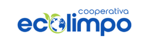

<div align="center">



# App Ecolimpo — Coleta Seletiva

**Aplicativo web que organiza a coleta de recicláveis nos condomínios atendidos pela Cooperativa Ecolimpo (São Sebastião – DF).**

<a href="https://app.cooperaecolimpo.com.br"></a> 

     

</div>

---

## 📌 Sobre o projeto

Moradores dos condomínios atendidos pela cooperativa usam o app para saber **quando a coleta passa**, **como separar o lixo** e **falar com a cooperativa**. A equipe da Ecolimpo usa um **painel administrativo** para acompanhar os condomínios, ler as respostas e publicar avisos.

Projeto real, em produção, desenvolvido por mim do início ao fim: telas, servidor, banco de dados e publicação.

## ✨ Funcionalidades

- **Escolha do condomínio** e dias da coleta seletiva
- **Guia de separação** de recicláveis para os moradores
- **Lembrete no celular** (notificação push) no dia da coleta
- **Pesquisa e fale conosco** com proteção anti-robô (Cloudflare Turnstile)
- **Painel da cooperativa** com login em duas etapas: condomínios, respostas, avisos e backup
- **Cartaz com QR Code** para divulgar o app no condomínio
- Página de **privacidade** de acordo com a LGPD

## 🧠 Destaques técnicos

- Front-end em **React + Vite**, com rotas pelo React Router
- Banco de dados e autenticação no **Supabase** (PostgreSQL)
- Funções de servidor na **Vercel** (pasta `api/`) — a chave secreta nunca vai para o navegador
- Notificações com **Web Push** e tarefa diária agendada
- **Testes automatizados** (`npm test`) para regras, privacidade, painel e envio

## 🚀 Como rodar localmente

```bash
git clone https://github.com/fabiorodrigueslima/app-ecolimpo.git
cd app-ecolimpo
npm install
cp .env.example .env   # preencha as chaves do Supabase
npm run dev
```

---

## 👨‍💻 Autor

**Fabio Rodrigues de Lima** — Desenvolvedor Full Stack

[](https://fabiorodriguesdev.com.br)
[](https://github.com/fabiorodrigueslima)
[](https://www.linkedin.com/in/f%C3%A1bio-rodrigues-a89b543a4)
